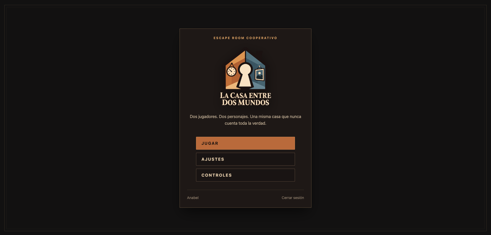
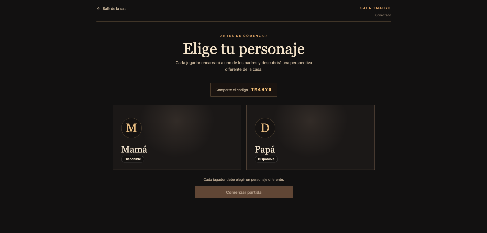
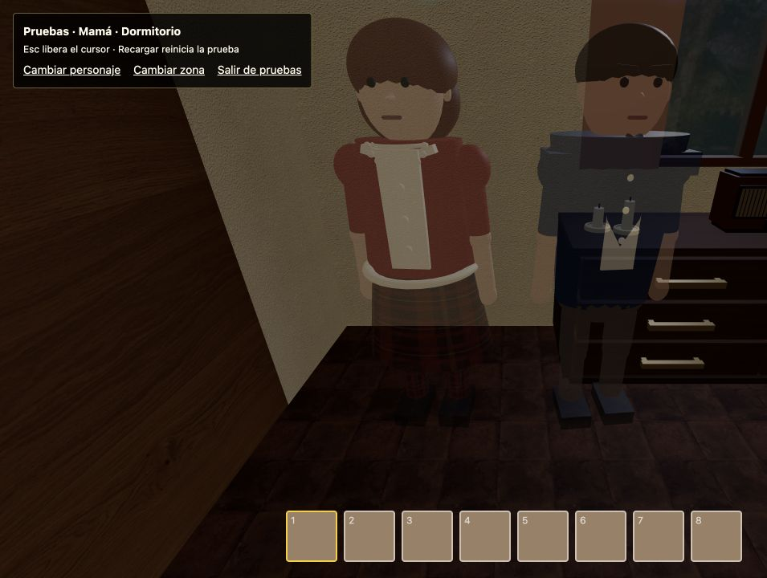
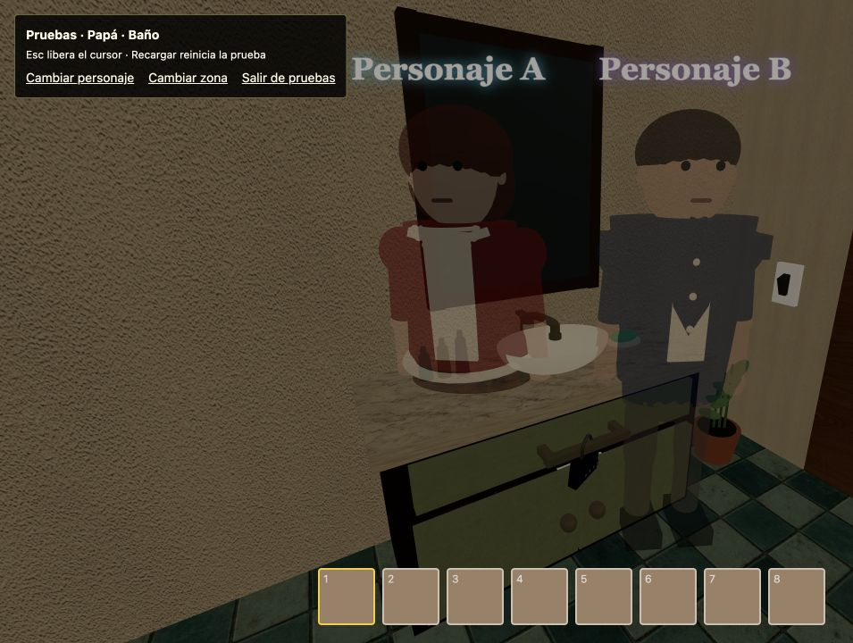

# La casa entre dos mundos

Escape room cooperativo en primera persona desarrollado como Trabajo Fin de Grado. Dos jugadores recorren versiones distintas de una misma casa —Mamá y Papá— y deben comunicarse para resolver puzles conectados, reconstruir la historia familiar y alcanzar juntos la salida.

## Descripción

Cada jugador observa objetos, pistas y estados diferentes. Una acción realizada en una versión de la casa puede desbloquear información o mecanismos en la otra, por lo que la cooperación es parte central del diseño.

El proyecto combina un escenario tridimensional construido con Three.js, una interfaz React y un servidor multijugador en tiempo real. Las partidas, los inventarios, el progreso de los puzles y la posición individual de cada jugador se conservan para poder continuar más adelante.

## Funcionalidades principales

- Escape room cooperativo para dos jugadores.
- Dos personajes, Mamá y Papá, con perspectivas y puzles complementarios.
- Casa 3D explorable con dormitorio, pasillo, salón, habitación infantil, baño y cocina.
- Puzles de lógica, observación, memoria, música, electricidad, laberinto y manipulación de objetos.
- Inventario, inspección de pistas y diario narrativo.
- Sistema de pistas contextual según el progreso de cada jugador.
- Sincronización en tiempo real mediante Socket.IO.
- Cuentas, sesiones persistentes y recuperación de contraseña.
- Tres huecos de guardado por cuenta.
- Puntos de continuación con habitación, posición, orientación, diario y pistas consultadas.
- Final cooperativo y reproducción posterior de la secuencia final.
- Interfaz disponible en español, inglés y francés.
- Ajustes persistentes de sonido y sensibilidad del ratón.
- Modo de pruebas para acceder directamente a personajes, habitaciones, recursos y final.

## Capturas

| Menú principal | Sala de espera |
| --- | --- |
|  |  |

| Perspectiva de Mamá | Perspectiva de Papá |
| --- | --- |
|  |  |

## Tecnologías

### Cliente

- React 19
- Vite 7
- Three.js
- Tailwind CSS
- Socket.IO Client
- Lucide React

### Servidor

- Node.js 22
- Express 5
- Socket.IO
- Sequelize 6
- PostgreSQL 16
- Zod
- Brevo para recuperación de contraseña

### Infraestructura y calidad

- Docker Compose para PostgreSQL local
- Vercel para el cliente
- Render para el servidor
- ESLint
- `node:test` y c8 para pruebas y cobertura

## Arquitectura

El repositorio está dividido en dos aplicaciones independientes:

```text
tfg-escape-room/
├── backend/
│   ├── migrations/       # Migraciones incrementales de PostgreSQL
│   ├── src/              # API, autenticación, Socket.IO y persistencia
│   └── test/             # Pruebas unitarias y de integración del servidor
├── frontend/
│   ├── public/           # Imágenes, sonidos y texturas
│   ├── src/
│   │   ├── components/   # Interfaz React
│   │   ├── game/         # Motor, gestores, controles, audio y sincronización
│   │   ├── translations/ # Español, inglés y francés
│   │   └── world/        # Habitaciones, objetos y puzles por estancia
│   └── test/             # Pruebas unitarias, de integración y utilidades
├── docs/                 # Documentación complementaria
├── docker-compose.yml    # PostgreSQL para desarrollo
├── netlify.toml          # Configuración anterior de Netlify
└── frontend/vercel.json  # Construcción, API y rutas del despliegue web
```

El cliente mantiene la representación visual y la interacción inmediata. El servidor valida las acciones, actualiza el estado compartido de la partida y distribuye los cambios a ambos jugadores. PostgreSQL conserva cuentas, sesiones, salas, eventos, inventarios y puntos de continuación.

## Requisitos

- Node.js 22 o superior.
- npm.
- Docker y Docker Compose, recomendados para ejecutar PostgreSQL.
- Dos ventanas o navegadores si se quiere probar una partida cooperativa completa.

## Instalación local

### 1. Clonar el repositorio

```bash
git clone https://github.com/anabelmenam/tfg-escape-room.git
cd tfg-escape-room
```

### 2. Iniciar PostgreSQL

```bash
docker compose up -d postgres
```

La base de datos queda disponible en `localhost:5434` con la configuración de desarrollo incluida en `docker-compose.yml`.

### 3. Configurar y arrancar el servidor

```bash
cd backend
cp .env.example .env
npm install
npm run migrate
npm run dev
```

El servidor HTTP y Socket.IO quedan disponibles en `http://localhost:3010`.

### 4. Arrancar el cliente

En otra terminal:

```bash
cd frontend
npm install
npm run dev
```

Vite mostrará la dirección local, normalmente `http://localhost:5173`.

## Variables de entorno

El servidor utiliza las siguientes variables:

| Variable | Descripción |
| --- | --- |
| `DATABASE_URL` | Cadena de conexión a PostgreSQL. |
| `FRONTEND_ORIGIN` | Origen autorizado del cliente. En local: `http://localhost:5173`. |
| `BREVO_API_KEY` | Clave de la API de Brevo para recuperar contraseñas. |
| `EMAIL_FROM_ADDRESS` | Remitente verificado en Brevo. |
| `EMAIL_FROM_NAME` | Nombre visible del remitente. |
| `PORT` | Puerto del servidor. Si se omite, se utiliza `3010`. |

Puede partirse del archivo [backend/.env.example](backend/.env.example).

El cliente funciona en desarrollo con `http://localhost:3010` por defecto. Si se necesita otro servidor pueden definirse:

```env
VITE_API_URL=http://localhost:3010
VITE_SOCKET_URL=http://localhost:3010
```

## Cómo jugar

1. Cada jugador crea una cuenta o inicia sesión.
2. Uno crea una partida en uno de sus tres huecos guardados.
3. El segundo utiliza el código de seis caracteres para unirse.
4. En el lobby, cada persona elige un personaje diferente: Mamá o Papá.
5. Ambos deben estar conectados para comenzar.
6. Las pistas encontradas deben comunicarse: muchos puzles solo pueden resolverse con información visible para el compañero.

### Controles

| Acción | Control |
| --- | --- |
| Moverse | `W`, `A`, `S`, `D` |
| Mirar y seleccionar | Ratón |
| Interactuar, recoger o colocar | `E` |
| Correr | `Ctrl` |
| Agacharse | `Shift` |
| Saltar | `Espacio` |
| Encender o apagar la linterna | `Q` |
| Seleccionar inventario | `1`–`8` o rueda del ratón |
| Inspeccionar determinados objetos | `R` |
| Cambiar de vista | `F` |
| Pausa o cerrar inspección | `Esc` |

## Modo de pruebas

En desarrollo se puede acceder directamente a distintas zonas sin crear una sala ni conectar un segundo jugador:

```text
http://localhost:5173/?character=mum
http://localhost:5173/?character=dad
http://localhost:5173/?test=icons
http://localhost:5173/?test=ending
```

Los valores admitidos para `character` son `mum` y `dad`. Cada uno inicia un recorrido de administración por la casa completa. `test=icons` abre el catálogo visual de recursos y `test=ending` reproduce la secuencia final. Estas rutas solo se habilitan en desarrollo.

Las cuentas administradoras también disponen de accesos visuales a estas pruebas desde el menú. Para crear o actualizar una cuenta administradora:

```bash
cd backend
ADMIN_EMAIL=correo@example.com \
ADMIN_PASSWORD=contraseña-segura \
ADMIN_NAME=Administrador \
npm run admin:create
```

## Pruebas y cobertura

El proyecto incluye pruebas unitarias de inventario, controles, colisiones, laberinto, pistas, audio, linterna, traducciones, autenticación, correo, estado inicial y validación de modelos.

### Cliente

```bash
cd frontend
npm test
npm run test:coverage
npm run check
```

### Servidor

```bash
cd backend
npm test
npm run test:coverage
npm run check
```

`npm run check` ejecuta las pruebas y las comprobaciones propias de cada paquete. En el cliente también ejecuta ESLint y genera la compilación de producción. En el servidor comprueba la sintaxis de los módulos y ejecuta las pruebas.

La estrategia y el catálogo actual de pruebas se explican en [docs/TESTING.md](docs/TESTING.md).

## Migraciones

Para aplicar todas las migraciones pendientes:

```bash
cd backend
npm run migrate
```

El arranque de producción (`npm start`) aplica automáticamente las migraciones antes de iniciar el servidor.

Para revertir la última migración:

```bash
npm run migrate:undo
```

Esta operación puede eliminar datos si la migración revertida creó o transformó tablas. Debe utilizarse con precaución.

## Despliegue

La configuración principal contempla:

- Cliente construido por Vercel desde `frontend/`.
- Reescritura de `/api/*` hacia el servidor de Render para mantener las
  peticiones y la cookie de sesión en el mismo origen.
- Comunicación Socket.IO directa con el backend de Render.
- PostgreSQL externo configurado mediante `DATABASE_URL`.

### Desplegar el cliente en Vercel

1. Importar este repositorio desde el panel de Vercel.
2. Seleccionar `frontend` como **Root Directory**.
3. Mantener el framework detectado como **Vite**. La construcción y la carpeta
   de salida ya están definidas en `frontend/vercel.json`.
4. Añadir esta variable para los entornos Production y Preview:

   ```env
   VITE_SOCKET_URL=https://tfg-escape-room.onrender.com
   ```

5. Realizar el primer despliegue y copiar su dominio de producción, por ejemplo
   `https://nombre-del-proyecto.vercel.app`.
6. En Render, sustituir `FRONTEND_ORIGIN` por ese dominio exacto y volver a
   desplegar el servidor. No debe añadirse una barra `/` al final.

La regla de la API se evalúa antes que la navegación SPA. Por ello, las rutas
`/api/*` llegan a Render y el resto de rutas del navegador cargan `index.html`.
El archivo `netlify.toml` se conserva temporalmente para que la versión actual
siga disponible hasta comprobar el nuevo despliegue.

Después del cambio deben verificarse, en este orden: registro o inicio de
sesión, recarga manteniendo la sesión, creación y unión a una sala desde dos
navegadores, sincronización de movimientos y recuperación de contraseña.

Para generar manualmente el cliente de producción:

```bash
cd frontend
npm run build
```

El resultado se genera en `frontend/dist/`.

## Seguridad

- Contraseñas derivadas con `scrypt` y sal aleatoria.
- Tokens de sesión almacenados como hashes SHA-256.
- Cookies `HttpOnly`, `SameSite` y `Secure` en producción.
- Validación de entradas mediante Zod y validaciones de Sequelize.
- Acciones multijugador comprobadas en el servidor.
- Tokens de recuperación de contraseña de un solo uso y con caducidad.
- Invalidación de sesiones anteriores tras cambiar la contraseña.

## Estado del proyecto

Proyecto académico en desarrollo. La suite automatizada protege la lógica principal, aunque una partida cooperativa completa también requiere validación manual en dos clientes por su componente gráfico y en tiempo real.

